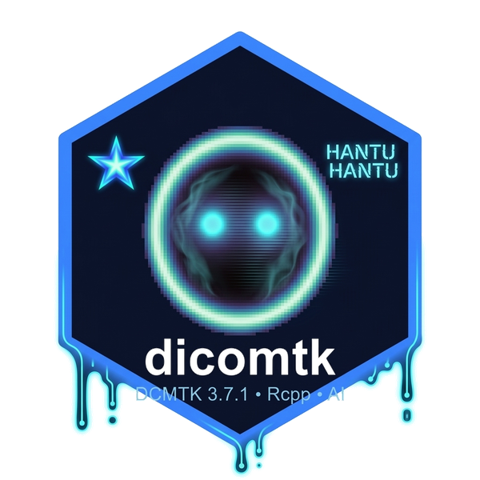

# dicomtk: Comprehensive 'DICOM' Toolkit for Medical Imaging in R 

<!-- badges: start -->
[](https://github.com/lauyeehow1986-hub/dicomtk/actions/workflows/R-CMD-check.yaml)
[](https://github.com/lauyeehow1986-hub/dicomtk/actions/workflows/sync-upstream-dcmtk.yaml)
[](https://lauyeehow1986-hub.r-universe.dev)
<!-- badges: end -->

`dicomtk` (`0.6.0`) is the core R package of the four-package **dicomtk** imaging ecosystem (`dicomtk`, [`dicomtk.ai`](https://lauyeehow1986-hub.github.io/dicomtk.ai/), [`dicomtk.server`](https://lauyeehow1986-hub.github.io/dicomtk.server/), [`dicomtk.fl`](https://lauyeehow1986-hub.github.io/dicomtk.fl/)). It is synchronized with **OFFIS DCMTK 3.7.1 (PS 3.6-2026d)** and powered by a **bundled C++17 / Rcpp engine** requiring zero external installation.

---

## Installation

Install pre-compiled binaries or source directly from [R-Universe](https://lauyeehow1986-hub.r-universe.dev):

```r
install.packages(
  "dicomtk",
  repos = c(
    "https://lauyeehow1986-hub.r-universe.dev",
    "https://cloud.r-project.org"
  )
)
```

Or install from GitHub:

```r
remotes::install_github("lauyeehow1986-hub/dicomtk")
```

---

## How to Use `dicomtk`

### 1. Read Headers, 3D Volumes & Coordinate Transforms
```r
library(dicomtk)
library(dplyr)

dcm_file <- system.file("extdata", "example.dcm", package = "dicomtk")

# Read DICOM metadata as a tidy tibble
read_dicom(dcm_file) |>
  filter(group == "0028") |>
  select(tag, vr, keyword, value)

# Synthesize a 3D multi-slice phantom & reconstruct a 3D dicom_volume (LPS/RAS)
tmp_dir <- tempfile("phantom_")
dicom_synthesize("CT", slices = 16, out_dir = tmp_dir)
vol <- read_dicom_volume(tmp_dir)
ras_vol <- to_ras(vol)
voxel_to_world(vol, c(1, 1, 1))
```

### 2. Regulatory-Grade De-Identification (PS 3.15, Pixel Cleaning & Defacing)
```r
kp <- dicom_key_provider("my-consortium-hmac-key")
out_deid <- tempfile("deid_")

# Jurisdiction-aware de-identification (HIPAA, GDPR, PDPA, or custom profile)
res <- dicom_deid(
  tmp_dir,
  out_dir = out_deid,
  jurisdiction = "HIPAA",
  key = kp,
  verify = TRUE
)

# Check residual re-identification risk & verify cryptographic attestation
dicom_deid_risk(out_deid)
dicom_verify_attestation(res$attestation)
```

### 3. Segmentation (`DICOM-SEG`), Radiotherapy (`RTSTRUCT`/`RTDOSE`/`DVH`) & `TID 1500` SR
```r
# Convert 3D mask to dicom_seg and RTSTRUCT
mask <- array(0L, dim = dim(vol$voxels))
mask[20:40, 20:40, 4:12] <- 1L
seg <- dicom_seg(mask, reference = vol, labels = "Lesion")
rt <- seg_to_rtstruct(seg, reference = vol)

# Compute Dose-Volume Histogram (DVH) and TID 1500 Measurement Report
# dvh <- dicom_dvh(rtdose, seg)
# sr <- dicom_sr_tid1500(seg, reference = vol)
```

### 4. Deep Learning Dataset Export (`nnU-Net`, `MONAI`, `RO-Crate`) & QC
```r
# Resample to isotropic spacing and check automated image QC
iso_vol <- volume_resample(vol, spacing = c(1.5, 1.5, 1.5))
qc <- dicom_image_qc(iso_vol)

# Export patient-level train/val splits for nnU-Net v2 or MONAI
# export_nnunet(...) / export_monai(...)
```

### 5. Interoperability: DICOMweb, HL7 FHIR, DuckDB Index & OMOP `MI-CDM`
```r
# Build a normalized DuckDB archive index & export OMOP MI-CDM tables
idx <- dicom_index_build(out_deid)
occ <- to_omop_image_occurrence(idx)
```

### 6. Whole-Slide Imaging (WSI) Pyramids & Supplement 222 Annotations
```r
# Synthesize or read a multi-resolution WSI pyramid & stitch a region
wsi_dir <- tempfile("wsi_")
dicom_synthesize_wsi(out_dir = wsi_dir)
pyr <- read_dicom_wsi_pyramid(wsi_dir)
region <- wsi_stitch_region(pyr, level = 1L, x = 1L, y = 1L, width = 64L, height = 64L)
```

### 7. Documentation & Vignettes
Browse the full function reference and vignettes on the [pkgdown site](https://lauyeehow1986-hub.github.io/dicomtk/).
