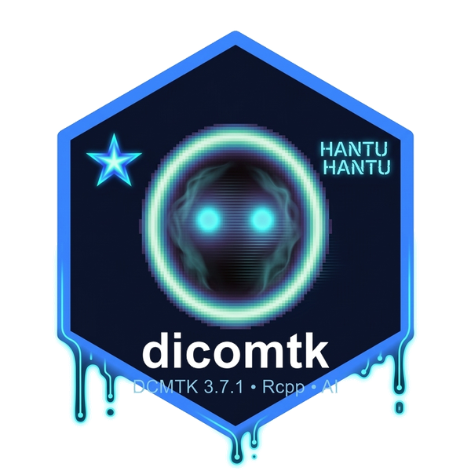

# dicomtk: Comprehensive 'DICOM' Toolkit for Medical Imaging in R 

<!-- badges: start -->
[](https://github.com/lauyeehow1986-hub/dicomtk/actions/workflows/R-CMD-check.yaml)
[](https://github.com/lauyeehow1986-hub/dicomtk/actions/workflows/sync-upstream-dcmtk.yaml)
[](https://lauyeehow1986-hub.r-universe.dev)
<!-- badges: end -->

`dicomtk` is a complete, modern rebuild of the R `dcmtk` wrapper, synchronized with **OFFIS DCMTK 3.7.1 (PS 3.6-2026d)** and powered by a **bundled C++17 / Rcpp engine** requiring **zero external installation**.

## Installation

Install pre-compiled binaries or source directly from [R-Universe](https://lauyeehow1986-hub.r-universe.dev):

```r
install.packages(
  "dicomtk",
  repos = c(
    "https://lauyeehow1986-hub.r-universe.dev",
    "https://cloud.r-project.org"
  )
)
```

Or install the development version from GitHub:

```r
# install.packages("remotes")
remotes::install_github("lauyeehow1986-hub/dicomtk")
```

## Key Features

- **Zero External Dependencies**: Bundles the full 5,354-tag DCMTK 3.7.1 data dictionary, headers (`inst/include/dcmtk/`), and native C++17 DICOM engine directly inside the package.
- **Tidyverse Compliant**: All tabular functions (`read_dicom()`, `dicom_tags()`, `dicom_find()`, `read_dicom_sr()`, `dicom_report()`) return `tibble` objects (`tbl_df`) and compose naturally with `|>` and `dplyr`/`tidyr`.
- **Full DCMTK Module Coverage**:
  - **Core (`dcmdata`)**: `read_dicom()`, `read_dicom_header()`, `write_dicom()`, `dicom_tags()`, `dicom_modify()`, `dicom_tag_value()`, `dicom_tag_lookup()`, `dicom_anonymize()`, `dcm2xml()`, `dcm2json()`, `dcm2pdf()`.
  - **Image Processing & Codecs (`dcmimgle`, `dcmimage`, `dcmjpeg`, `dcmjpls`)**: `read_dicom_pixels()`, `read_dicom_series()`, `dicom_window()`, `dicom_compress()`, `dicom_decompress()`, `dicom_to_png()`, `dicom_to_nifti()`.
  - **Visualization**: `plot_dicom()` and `ggdicom()` (`ggplot2` with clinical CT/MR window presets), `dicom_viewer()` (interactive `Shiny` app), and `render_volume()` (3-plane MPR, MIP, and interactive `rgl` 3D rendering).
  - **PACS Networking (`dcmnet`, `dcmqrdb`, `dcmwlm`)**: `dicom_connect()`, `dicom_echo()`, `dicom_find()`, `dicom_get()`, `dicom_send()`, `dicom_receive()`.
  - **Structured Reporting & Specialized IODs (`dcmsr`, `dcmrt`, `dcmseg`, `dcmpmap`, `dcmtract`, `dcmect`, `dcmsign`)**: `read_dicom_sr()`, `create_dicom_sr()`, `read_dicom_rt()`, `read_dicom_seg()`, `read_dicom_pmap()`, `read_dicom_ect()`, `dicom_verify_signature()`.
- **Local & Cloud LLM Integration**:
  - Native support for **local Ollama** (`http://localhost:11434`), **OpenAI** (`gpt-4o`, etc.), **Anthropic Claude** (`claude-sonnet-4-20250514`, etc.), and any **OpenAI-compatible endpoint** (vLLM, LM Studio, OpenRouter, Azure).
  - Automatic HIPAA Safe Harbor de-identification before sending metadata or images to remote APIs.
- **100% Backward Compatible**: Preserves legacy `dcmtk` functions (`dcmdump()`, `dcmhd()`, `wide_hdr()`, `burned_annot()`, `dcmodify()`, `dcm_anon()`, `dcm_subtract_date()`, `dcmj2pnm()`, `dcmdjpeg()`, `dcmdrle()`, `dcmcrle()`).

## Quick Start

```r
library(dicomtk)
library(dplyr)

dcm_file <- system.file("extdata", "example.dcm", package = "dicomtk")

# 1. Read DICOM header as a tidy tibble
read_dicom(dcm_file) |>
  filter(group == "0028") |>
  select(tag, vr, keyword, value)

# 2. Visualize with ggplot2 and clinical CT/MR window presets
plot_dicom(dcm_file, window = "auto", palette = "gray")

# 3. Launch interactive Shiny DICOM viewer
if (interactive()) {
  dicom_viewer(dcm_file)
}

# 4. Connect to Local Ollama or OpenAI / Claude for AI-Assisted Analysis
llm <- dicom_llm("ollama", model = "llava:13b")
dicom_summarize(dcm_file, llm = llm)
dicom_describe_image(dcm_file, llm = llm)
dicom_report(dcm_file, llm = llm)
```
