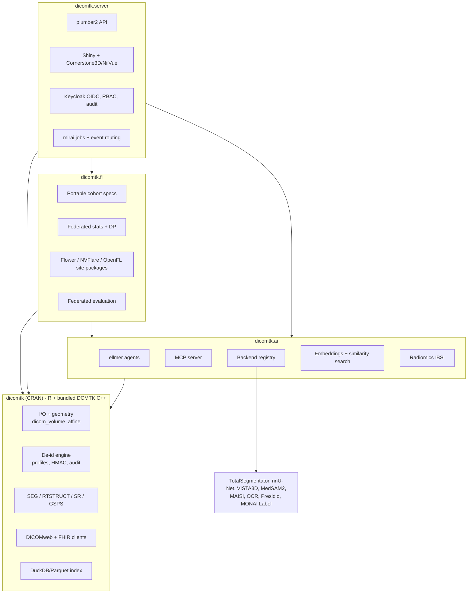
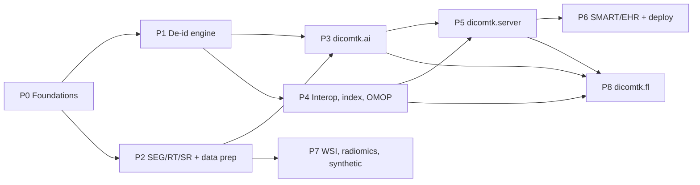

# dicomtk — Next-Phase Roadmap (v0.2 → v1.x)

> [!NOTE]
> Status: **VALIDATED (2026-10-24).** Canonical copy: `dev/plans/2026-10-24-roadmap-v0.2-v1.0-design.md` in the dicomtk repo. (`docs/` is pkgdown output, so plans live in `dev/`.)

## 0. Decisions so far

| Q | Decision |
|---|---|
| Users | **Layered multi-user**: an R core that serves every persona, plus an optional shared server with logins, roles and per-project audit |
| Packaging | **Satellites**: `dicomtk` (CRAN core) · `dicomtk.ai` · `dicomtk.server` · **`dicomtk.fl`** (new). Satellites ship on R-universe first |
| Python | **Backend-agnostic**: Docker/REST (preferred) or optional `reticulate`. Core never needs Python |
| Modalities | **All**: CT, MR (+defacing), PET/NM (SUV), US/SC, DX/CR/MG/DBT, RT, XA cine, WSI |
| De-id presets | **All**: PS3.15 + options, HIPAA SH + Expert Determination, MY PDPA (2024), SG PDPA/MOH, GDPR/UK GDPR, TCIA/CTP, AU Privacy Act/NHMRC, plus custom YAML |
| Infra | Docker, NVIDIA GPU, cloud account, Ollama. **Hospital PACS/VNA and Epic are simulated** (§3) |
| Ambition | **Everything in scope**, including federated learning, inpainting, burned annotations and radiomics. Nothing is parked |
| Key custody | `local` / `broker` / `ttp`. **Honest broker is the server default**; the `pi` never sees keys in broker/TTP modes |
| Sequence | P0 → P1 → P2 first (confirmed) |

---

## 1. Evaluation of Grok's proposals

| # | Feature | Verdict | Change vs Grok |
|---|---|---|---|
| 1 | Research-grade de-id | ✅ Top priority | Full PS3.15 E.1-1 action-code engine; **keyed HMAC** UID/date mapping. Black-box masking is the default; **inpainting is opt-in with guard-rails** (see below) |
| 2 | Agentic de-id | ✅ With guard-rail | **The rule engine is authoritative. The LLM plans and audits but can never weaken the profile.** This is enforced by a property test |
| 3 | Segmentation | ✅ | Native `dcmseg` writer; add **RTSTRUCT↔mask** and **label-map SEG (Sup 243)** |
| 4 | DL data prep | ✅ | Blocked on geometry fixes (P0). Add nnU-Net v2 / MONAI / R `torch` exports |
| 5 | Annotation | ✅ | Primary storage is **GSPS** + **SR TID 1500**. **Burned-in annotations are allowed only as derived exports** (see below). Viewer: **Cornerstone3D/OHIF + NiiVue** htmlwidgets |
| 6 | DICOMweb/FHIR/provenance/parallel | ✅ | Add W3C PROV / FHIR `Provenance`, `mirai` parallelism |
| EHR | SMART on FHIR / Epic | ⚠️ Scoped | Research-use SMART app first. Chart write-back moves toward **SaMD** regulation, so it stays behind a feature flag |

### Guard-rails on features that can harm data integrity

| Feature | Guard-rail |
|---|---|
| **Pixel inpainting** (burned-in PHI) | Off by default; `pixel_method = "inpaint"` must be chosen explicitly. Every run is recorded in `DeidentificationMethodCodeSequence (0012,0064)` and the provenance log, with a sidecar mask of the modified regions. Output gets new SOP Instance UIDs and is never presented as original pixels |
| **Burned-in annotations** | Written only to a **new derived series** (Secondary Capture / PNG / MP4 for teaching), with `ImageType = DERIVED\SECONDARY`. The source is never overwritten |
| **Federated statistics** | Differential privacy (configurable ε) and minimum cell counts before anything leaves a site |

### Audit of v0.1.0: correctness debt that must be fixed first

- [read_dicom_series()](file:///C:/Users/lauye/.gemini/antigravity/scratch/dicomtk/R/read.R#L147-L189) sorts by `InstanceNumber`, uses `SliceThickness` as spacing and reads frame 1 only. It has **no affine**.
- [dicom_to_nifti()](file:///C:/Users/lauye/.gemini/antigravity/scratch/dicomtk/R/convert.R#L71) writes no qform/sform, so masks won't align in Slicer or nnU-Net.
- [dicom_anonymize()](file:///C:/Users/lauye/.gemini/antigravity/scratch/dicomtk/R/anonymize.R) uses random UIDs, which **break linkage across files**. It also shifts dates per call (not per patient), zeroes all times, doesn't recurse into sequences and keeps no audit log.
- [read_dicom_seg()](file:///C:/Users/lauye/.gemini/antigravity/scratch/dicomtk/R/rt_seg.R#L88-L100) has no frame→segment mapping and no writer.
- The test corpus is a single `example.dcm`.

---

## 2. Architecture (layered, multi-user, federated)

**Key design principles**
1. **One canonical in-memory object**: `dicom_volume` (voxels + 4×4 affine + per-frame metadata + provenance).
2. **Profiles and cohort specs are data**: versioned YAML/JSON. Jurisdiction presets inherit from the PS3.15 base. *Presets are templates, not legal advice.*
3. **Every mutating operation emits provenance** (JSONL, convertible to FHIR `Provenance` / W3C PROV).
4. **Pure functions in core.** Users, projects, queues and federation state live only in satellites.
5. **Roles** (server): `pi`, `coordinator`, `annotator`, `auditor`, `admin`, `site_admin` (federation: approves outbound stats and model updates), **`honest_broker`** (custodian of keys and crosswalk) and **`dpo`** (co-approves re-identification requests).
6. **Data never leaves a site in federated mode.** Only aggregated, DP-protected statistics, model weights and metrics leave.
7. **Key custody is a setting**: `key_custody = "local" | "broker" | "ttp"`.

| Mode | Key holder | Where de-id runs | Default for |
|---|---|---|---|
| `local` | `pi` | Inside the research project | Core R package (single user) |
| `broker` | `honest_broker`; key in HashiCorp Vault / cloud KMS, never shown in UI | Same server, walled-off broker workspace | **`dicomtk.server` default** |
| `ttp` | External organisation running `dicomtk.server` in broker mode | Hospital → TTP (identified) → research env (pseudonymised only) | Multi-centre, GDPR, registries, federation |

   In `broker` and `ttp` modes the `pi` never sees the key. Re-identification (e.g. returning an incidental finding) follows a workflow: request → reason code → two-person approval (`honest_broker` + `dpo`/IRB) → time-limited disclosure → audit log.

---

## 3. Simulated hospital test lab (`dicomtk-lab` docker-compose)

| Real-world system | Simulated by | Used for |
|---|---|---|
| Enterprise PACS / VNA | **dcm4chee-arc-light** (+ Keycloak) | DIMSE + DICOMweb with OAuth2 |
| Research PACS / modality | **Orthanc** (+ DICOMweb plugin) | C-STORE/FIND/MOVE, STOW write-back, event routing |
| Epic FHIR R4 | **HAPI FHIR** + **Epic public sandbox** (fhir.epic.com) | ImagingStudy, DiagnosticReport, Provenance |
| Epic SMART launch | **SMART Health IT launcher** | EHR-launch, PKCE |
| Linked patients | **Synthea Coherent Data Set** (FHIR + DICOM) | Imaging ↔ clinical linkage, OMOP MI-CDM |
| OMOP / OHDSI | **Broadsea** (OHDSI stack in Docker) | MI-CDM imaging extension, cohort definitions |
| HL7 v2 ORM/ORU | **NextGen (Mirth) Connect** | Order→study→report flows |
| Identity | **Keycloak** | Multi-user OIDC, roles |
| **Federated network** | **3 simulated sites** (separate Orthanc + dicomtk.server containers, each with its own data partition) + **Flower superlink** / **NVFlare** server | FL training, federated stats, federated evaluation |
| Cloud | GCP Healthcare / Azure HDS / AWS HealthImaging | Cloud DICOMweb conformance |
| Public data | **NCI IDC** DICOMweb, TCIA, pydicom/highdicom/dcm_qa | Fixture corpus incl. SEG, SR, enhanced MF, WSI, PET |
| De-id ground truth | **MIDI-B** (TCIA) | Quantitative de-id benchmark |

> [!TIP]
> Fixtures are downloaded in CI and cached, never bundled. CRAN tests use only `dicom_synthesize()` phantoms.

**Decision:** the lab lives in its **own repository** (`lauyeehow1986-hub/dicomtk-lab`), versioned separately, with docker-compose **profiles**:

| Profile | Containers | Needed from phase |
|---|---|---|
| `core` | Orthanc, dcm4chee, Keycloak | P0 |
| `ai` | GPU model containers (TotalSegmentator, MedSAM2, MONAI Label, MAISI) | P3 |
| `ehr` | HAPI FHIR, SMART launcher, Synthea loader, Mirth | P4 |
| `ohdsi` | Broadsea | P4 |
| `ttp` | Second `dicomtk.server` in broker mode + Vault | P5 |
| `fl` | 3 site stacks + Flower superlink / NVFlare | P8 |

dicomtk's CI starts `dicomtk-lab --profile core` for integration tests (skipped on CRAN). Each later profile joins CI when its phase begins.

---

## 4. Ambitious / state-of-the-art features (all in scope)

**Privacy & de-identification**
- **MIDI-B validated de-id**, with the score published.
- **`dicom_deid_verify()`**: residual-PHI scanner (headers, free text, OCR) producing a signed attestation (`dcmsign`).
- **Defacing** for head CT/MR; **WSI label/macro removal**; **opt-in inpainting** (guard-railed).
- **Re-identification risk scoring**: k-anonymity / l-diversity, for HIPAA Expert Determination and GDPR tests.
- **Radiology report de-id**: Presidio plus a local LLM, run over SR content and free-text reports.
- **Trusted-third-party pseudonymisation**: honest-broker and external-TTP custody modes; **two-stage pseudonyms** (site → TTP); **Mainzelliste-compatible pseudonym API**; **Bloom-filter privacy-preserving record linkage** across hospitals; **polymorphic encryption & pseudonymisation (PEP)**, where each recipient gets a different pseudonym for the same patient.

**Data & datasets**
- **`dicom_synthesize()`**: modality-realistic phantoms with planted PHI.
- **MONAI MAISI synthetic CT + masks**: generates shareable synthetic datasets when real data can't leave a site.
- **DuckDB/Parquet archive index** plus a **natural-language → SQL cohort builder**.
- **Protocol harmonisation**: maps messy `SeriesDescription`s to the **RadLex / LOINC-RSNA Radiology Playbook** (rules + local LLM).
- **OMOP MI-CDM export** (OHDSI imaging extension), linking imaging to clinical OMOP cohorts.
- **Report → label extraction**: a local LLM turns reports into structured weak labels for training.
- **RO-Crate + MLCommons Croissant** metadata on every export, plus datasheets and model cards.
- **Automated image QC**: artefact, protocol-deviation, truncation and motion detection, plus MRIQC-style metrics.

**AI & analysis**
- **MCP server**, and the LLM layer migrated to **`ellmer`**.
- **Segmentation backends**: TotalSegmentator, nnU-Net v2, MONAI **VISTA3D**, **MedSAM2** (interactive prompts), with **uncertainty maps**. Outputs go to SEG + SR TID 1500, aligned with **IHE AIR / AIW-I**.
- **Active learning loop** with **MONAI Label**: the clinician corrects, the model retrains, the next case is suggested.
- **Foundation-model embeddings** (e.g. RAD-DINO, BiomedCLIP, CT-FM) stored in DuckDB `vss` for **similar-case search**.
- **IBSI-compliant radiomics** (pyradiomics backend) with **ComBat harmonisation** across scanners and sites.
- **PET SUV** (bw/lbm/bsa, decay correction).
- **Clinician QA**: Dice, HD95 and surface Dice for AI vs human, plus a review/approve queue.

**Federated learning (`dicomtk.fl`)**
- **Portable cohort specs**: one JSON cohort definition, executed locally at each site against its DuckDB index.
- **Federated descriptive stats** with DP noise and minimum cell counts. Answers "how many eligible studies across 5 hospitals?" without moving data.
- **Site readiness check**: verifies a site's data meets the federation contract (geometry, labels, de-id profile, protocol mapping).
- **FL site packages**: per-site harmonised dataset plus loaders and job templates for **Flower**, **NVIDIA FLARE** and **OpenFL**.
- **Federated evaluation**: ship a model to sites, return only metrics, and produce a fairness/subgroup report.
- **Secure aggregation + DP-SGD** options passed through to the framework. Every outbound artefact needs `site_admin` approval and is audit-logged.

**Workflow & deployment**
- **Event-driven routing**: receive from a modality/PACS → auto de-id → auto QC → auto segment → push to a research PACS (rules engine).
- **Annotations burned into a derived series**, for teaching files and presentations.
- **SMART on FHIR** launch, a Docker image, SBOM and threat model.

---

## 5. Phased roadmap

| Phase | Package / version | Headline deliverables | Exit criteria |
|---|---|---|---|
| **P0** Foundations | `dicomtk` 0.2.0 | `dicom_volume`; IPP/IOP sorting + affine; true spacing, tilt/irregular detection; series splitting; enhanced MF, cine, DBT; PET SUV; MG/DX VOI LUT; NIfTI qform/sform; `dicom_synthesize()`; `dicomtk-lab`; CI fixtures | Affine matches **dcm2niix** within 1e-4; all modality fixtures load |
| **P1** De-id | `dicomtk` 0.3.0 | YAML profile engine from PS3.15 E.1-1 + all options; jurisdiction presets; HMAC UID + per-patient date shift; recursive sequences; safe-private allowlist; `dicom_deid()` parallel; audit + encrypted crosswalk; pluggable key-provider interface (`local` now; Vault/KMS hooks ready for P5); burned-in detection + black-box + **opt-in inpainting**; defacing; WSI label removal; `dicom_deid_verify()`; risk scoring | MIDI-B score published; 0 residual PHI on synthetic corpus; UID relationships preserved |
| **P2** SEG/RT/data prep | `dicomtk` 0.4.0 | SEG (binary/fractional/label-map); RTSTRUCT↔mask; RTDOSE; SR TID 1500; GSPS; preprocessing; patient-level splits; nnU-Net/MONAI/`torch` export; RO-Crate + Croissant; **derived burned-annotation export**; image QC | Opens correctly in 3D Slicer + OHIF; masks align with dcm2niix |
| **P3** AI & agents | `dicomtk.ai` 0.1.0 | `ellmer`; agent loop (plan→dry-run→approve→execute→verify); MCP server; backend registry (TotalSeg, nnU-Net, VISTA3D, MedSAM2, OCR, Presidio); uncertainty; report de-id; report→labels; protocol harmonisation; embeddings + similar-case search | Agent never weakens profile (property test); GPU backends run in lab |
| **P4** Interop & index | `dicomtk` 0.5.0 | DICOMweb QIDO/WADO/STOW + OAuth2; FHIR ImagingStudy/ImagingSelection/DiagnosticReport/Provenance; DuckDB index; NL→SQL; Synthea linkage; **OMOP MI-CDM** | Passes against Orthanc, dcm4chee, HAPI, Broadsea, ≥1 cloud |
| **P5** Multi-user server | `dicomtk.server` 0.1.0 | plumber2 + Shiny; Keycloak; RBAC; projects; audit; **`broker` custody mode** (Vault/KMS, walled broker workspace, re-identification request workflow with two-person approval); `mirai` jobs; Cornerstone3D/NiiVue; annotation + review queue; **MONAI Label active learning**; **event-driven routing**; Docker | All roles exercised end-to-end; audit trail complete; `pi` provably cannot read key material |
| **P6** EHR & deployment | `dicomtk.server` → **1.0** | SMART EHR-launch (PKCE); patient-context pull; de-id export; flagged write-back (STOW SEG/SR + DiagnosticReport); IHE AIW-I/AIR; SBOM + threat model | Launches from SMART launcher and Epic sandbox with patient context |
| **P7** WSI, radiomics, synthetic | `dicomtk` 0.6 / `dicomtk.ai` 0.2 | DICOM WSI pyramids + SM SEG/annotations; **IBSI radiomics + ComBat**; **MAISI synthetic data** | IDC WSI fixtures load; IBSI phantom features within tolerance |
| **P8** Federated | `dicomtk.fl` 0.1.0 | **`ttp` custody mode** (broker-mode server, two-stage pseudonyms, Mainzelliste API, Bloom-filter PPRL, PEP); portable cohort specs; federated stats + DP; site readiness check; Flower/NVFlare/OpenFL site packages; federated evaluation + fairness report; secure aggregation / DP-SGD pass-through; `site_admin` approval gate | 3-site lab trains nnU-Net via Flower with no raw data leaving sites; federated stats match pooled within the DP error bound |

## 6. P0 Foundations: validated detail

**`dicom_volume` S3 class**: voxel array + 4×4 LPS affine + spacing + direction cosines + per-frame metadata tibble + source UIDs + provenance list. Methods: `print`, `dim`, `as.array`, `[`, `plot` (via `ggdicom`), `to_ras()`, `to_lps()`.

**Readers**
- `read_dicom_volume(path, series_uid = NULL)`:
  - Groups files by `SeriesInstanceUID`, then splits by orientation, matrix size and echo/temporal position.
  - Sorts slices by `ImagePositionPatient` projected onto the slice normal.
  - Derives true spacing from slice positions, and warns on gaps, overlaps, gantry tilt and irregular spacing.
- Native C++ enhanced multi-frame (CT/MR/PET), XA/US cine and DBT via DCMTK `dcmfg`/`dcmiod`.
- Modality transforms:
  - PET SUV (bw/lbm/bsa, decay correction).
  - MG/DX VOI LUT + presentation intent.
  - Optional Philips private scaling for MR.

**Writers**: `write_nifti()` with correct qform/sform, matching dcm2niix orientation, plus a BIDS-style JSON sidecar.

**Testing**: `dicom_synthesize(modality, n_slices, orientation, phi = TRUE)`; CI fixture downloader (pydicom, highdicom, dcm_qa, IDC); `dicomtk-lab --profile core` integration tests (skipped on CRAN).

**Backward compatibility (decided)**: `read_dicom_series()` stays. It becomes a thin wrapper over `read_dicom_volume()`, keeps its return shape, gains an `affine` field and correct sorting, and is soft-deprecated via `lifecycle`. `dicom_to_nifti()` delegates to `write_nifti()`.

**Exit criteria**: affine matches dcm2niix within 1e-4 on every fixture; all modality fixtures load; `R CMD check --as-cran` clean on Windows/macOS/Linux.

## 7. Risks

> [!WARNING]
> - **Scope**: with everything included this is roughly **2+ years of solo work**. P0–P2 alone make dicomtk best-in-class in R. Consider recruiting contributors after P2, or using `/teamwork-preview` for parallel phases.
> - **CRAN**: the core must stay lean. Four satellites keep heavy dependencies out of it.
> - **Legal presets** need a disclaimer and ideally review by a privacy officer.
> - **Regulatory**: chart write-back and clinical-facing AI mean SaMD considerations (FDA / Malaysia MDA / HSA).
> - **Federated privacy**: model updates can leak data (membership inference). DP and secure aggregation are recommended defaults, not optional extras.
> - **Geometry** is the highest technical risk. Nothing downstream ships until P0 exit criteria pass.
