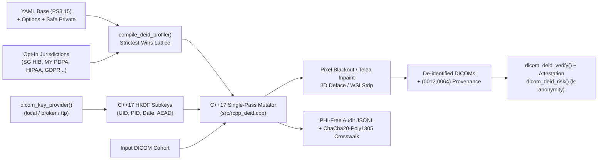

# Phase 1 (`v0.3.0` Research-Grade De-Identification Engine) — Architecture & Design

- **Date:** 2026-11-07
- **Target Version:** `dicomtk` `0.3.0` (CRAN Core Package)
- **Branch / Worktree:** `feature/p1-deid` (`.worktrees/p1-deid`)
- **Status:** Validated via `superpowers:brainstorming`

---

## 1. Objectives & Exit Criteria

Deliver a fast, pure R/C++17, regulatory-grade DICOM de-identification and privacy verification engine in `dicomtk` `v0.3.0` with **zero mandatory Python or external C crypto-library dependencies**:

1. **DICOM PS3.15 Annex E Table E.1-1 Engine**: Declarative YAML profiles implementing all PS3.15 action codes (`D`, `Z`, `X`, `K`, `C`, `U`, `X/Z`, `X/D`, `Z/D`, `X/Z/D`, `X/Z/U*`) and all 10 standard Confidentiality Options.
2. **Composable Jurisdiction Presets Toggle**: Off by default (`jurisdictions = NULL` runs pure PS3.15); users can turn on **one or multiple** jurisdiction overlays (`"hipaa_safe_harbor"`, `"hipaa_expert_determination"`, `"gdpr"`, `"uk_gdpr"`, `"sg_pdpa_hib"`, `"my_pdpa_2024"`, `"au_privacy_nhmrc"`, `"tcia_ctp"`) composed via a **monotonic strictest-wins lattice**.
3. **Zero-Dependency C++17 Cryptography & Pluggable Key Custody**: RFC 6234 `SHA-256`/`HMAC-SHA256`, RFC 2898 `PBKDF2`, RFC 5869 `HKDF`, and RFC 8439 `ChaCha20-Poly1305` AEAD in `src/rcpp_crypto.cpp`; `dicom_key_provider(mode = c("local", "broker", "ttp"))` with deterministic `2.25.<128-bit>` UID mapping, per-patient longitudinal date shifting, PHI-free JSONL audit logs, and AEAD-encrypted crosswalks.
4. **Recursive Sequence & Private-Creator Allowlist Engine**: Single-pass C++17 traversal (`depth <= 64`) resolving dynamic private creator blocks (`(gggg,0010)-(gggg,00FF)` -> `(gggg,1000)-(gggg,FFFF)`) to retain quantitative safe-private tags (e.g., Philips MR `2005`, PET SUV `7053`) while purging unknown private tags and orphan creator elements.
5. **Pixel PHI Cleaning, Guard-Railed Telea Inpainting, 3D Defacing & WSI Stripping**:
   - Ultrasound `(0018,6011)` region geometry + C++17 border stroke/temporal-variance detection + optional `tesseract` / `dicomtk.ai` callback hooks.
   - Default `pixel_method = "blackout"`; explicit opt-in `pixel_method = "inpaint"` (C++17 Fast Marching Telea diffusion) enforcing `DERIVED` `ImageType`, fresh `SOPInstanceUID`, `(0012,0064)` provenance, and binary mask sidecars.
   - Coordinate-aware 3D LPS/RAS head CT/MR facial-plane defacing (`dicom_deface()`) and WSI `LABEL`/`OVERVIEW` instance stripping.
6. **Verification, Attestation & Risk Scoring**: `dicom_deid_verify()` 4-surface scanner with signed attestations (`HMAC-SHA256` or optional `openssl` X.509/CMS) and `dicom_deid_risk()` cohort $k$-anonymity / $\ell$-diversity scoring.
7. **Exit Criteria**:
   - MIDI-B synthetic ground-truth corpus achieves **0 residual PHI** and **100% cross-series UID graph preservation**; external TCIA MIDI-B benchmark runner & scorecard published.
   - Monotonic lattice property tests confirm jurisdiction toggles never weaken base protection.
   - `R CMD check --as-cran` passes with **0 ERRORs | 0 WARNINGs** across Windows/macOS/Linux.

---

## 2. Dependency & CRAN Footprint Decisions

| Dependency | Placement | Rationale |
|---|---|---|
| C++17 `SHA-256`, `HMAC-SHA256`, `PBKDF2`, `HKDF`, `ChaCha20-Poly1305` | Built-in (`src/rcpp_crypto.cpp`) | Compiles everywhere on CRAN without `libssl-dev` or `libsodium-dev`. |
| `yaml` | `Imports` | Lightweight pure-C YAML parser (zero external OS libraries) for built-in and custom YAML profiles. |
| `openssl` | `Suggests` | Optional X.509 / PKCS#7 / CMS PKI attestation signatures when present; HMAC-SHA256 manifest digest used otherwise. |
| `mirai` | `Suggests` | Optional stateless multi-daemon cohort parallelism (`workers > 1L`); fast sequential C++17 loop fallback. |
| `tesseract` | `Suggests` | Optional local OCR engine for `dicom_detect_burned_phi(ocr = TRUE)`; deterministic tag/US-region/signal detector works without it. |

---

## 3. Component Architecture & Data Flow

### 3.1 Strictest-Wins Action Lattice
When composing PS3.15 options and enabled `jurisdictions`, conflicting tag rules merge monotonically along:
`X` (remove) `>` `Z` (zero/empty) `>` `D` (dummy) `>` `U` (HMAC UID) `>` `C` (clean regex/shift) `>` `K` (keep).
Explicit PS3.15 retention options (e.g., `options = "retain_patient_characteristics"`) apply to the PS3.15 base layer *before* enabled `jurisdictions` are overlaid, ensuring that turning on a legal preset (e.g., `jurisdictions = "hipaa_safe_harbor"` capping `PatientAge > 89Y` to `"090Y"`) always enforces the statutory floor unless the caller explicitly specifies `override_tags`.

### 3.2 Guard-Rails on Pixel Modification
- `pixel_method = "blackout"` is the default whenever `clean_pixel` is active.
- `pixel_method = "inpaint"` requires explicit opt-in, sets `ImageType` to `DERIVED\SECONDARY\...`, forces a new `SOPInstanceUID`, appends CID 7050 `113101` + inpainting method metadata to `(0012,0064)`, and writes a binary mask sidecar of modified voxel coordinates.
- `dicom_anonymize()` remains exported as a soft-deprecated (`lifecycle::deprecate_soft("0.3.0", ...)`) wrapper around `dicom_deid()` so all `v0.1`–`v0.2` scripts keep working unchanged.
