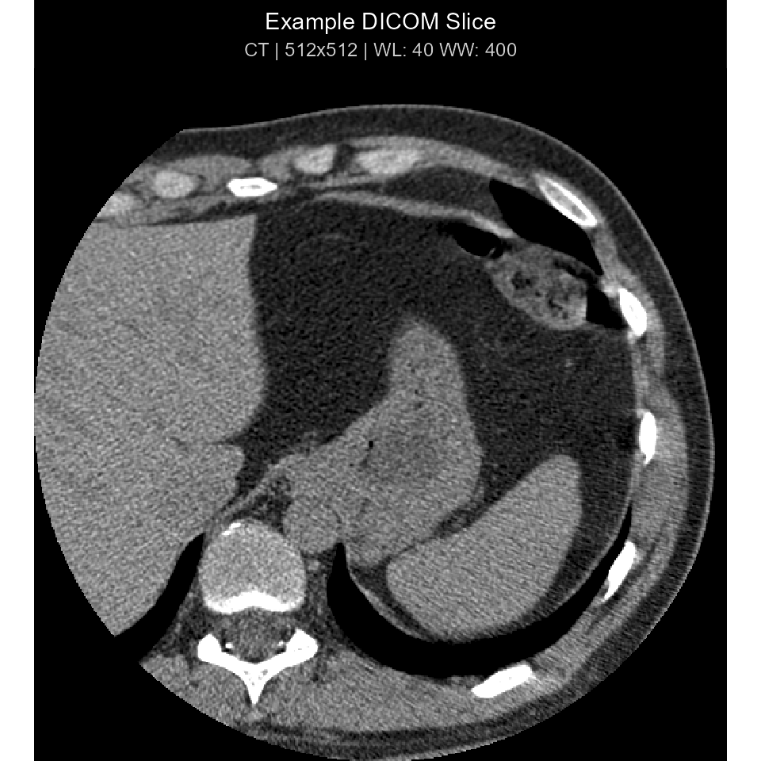

# Getting Started with dicomtk

## Overview

`dicomtk` is a self-contained, tidyverse-compliant R interface to the
OFFIS **DICOM Toolkit (DCMTK 3.7.1)** with native C++17 / `Rcpp`
bindings, `ggplot2` / `Shiny` / 3D volume visualization, PACS
networking, and local/cloud LLM integration (`Ollama`, `OpenAI`,
`Anthropic Claude`).

[`library`](https://rdrr.io/r/base/library.html)`(`[`dicomtk`](https://github.com/lauyeehow1986-hub/dicomtk)`)`` `[`library`](https://rdrr.io/r/base/library.html)`(`[`dplyr`](https://dplyr.tidyverse.org)`)`` ``#> `` ``#> Attaching package: 'dplyr'`` ``#> The following objects are masked from 'package:stats':`` ``#> `` ``#> filter, lag`` ``#> The following objects are masked from 'package:base':`` ``#> `` ``#> intersect, setdiff, setequal, union`` `` ``# Verify bundled DCMTK 3.7.1 engine & dictionary`` `[`dicom_info`](https://lauyeehow1986-hub.github.io/dicomtk/reference/dicom_info.md)`(``)`` ``#> ``# A tibble: 1 × 5`` ``#> dcmtk_version dictionary_standard dictionary_entries backend codecs_registered`` ``#> ``<chr>`` ``<chr>`` ``<int>`` ``<chr>`` ``<lgl>`` `` ``#> ``1`` 3.7.1 PS 3.6-2026d / PS … ``5``277 Bundle… TRUE`

## Reading DICOM Headers & Tidyverse Workflows

`dcm_file`` ``<-`` `[`system.file`](https://rdrr.io/r/base/system.file.html)`(``"extdata"``, ``"example.dcm"``, package ``=`` ``"dicomtk"``)`` `` ``# Long tidy tibble of DICOM elements`` ``hdr`` ``<-`` `[`read_dicom`](https://lauyeehow1986-hub.github.io/dicomtk/reference/read_dicom.md)`(``dcm_file``)`` ``hdr`` ``|>`` `` `[`filter`](https://dplyr.tidyverse.org/reference/filter.html)`(``group`` `[`%in%`](https://rdrr.io/r/base/match.html)` `[`c`](https://rdrr.io/r/base/c.html)`(``"0008"``, ``"0028"``)``)`` ``|>`` `` `[`select`](https://dplyr.tidyverse.org/reference/select.html)`(``tag``, ``vr``, ``keyword``, ``name``, ``value``)`` ``|>`` `` `[`head`](https://rdrr.io/r/utils/head.html)`(``10``)`` ``#> ``# A tibble: 10 × 5`` ``#> tag vr keyword name value `` ``#> ``<chr>`` ``<chr>`` ``<chr>`` ``<chr>`` ``<chr>`` `` ``#> `` 1`` (0008,0005) CS SpecificCharacterSet Specific Character Set ``"``ISO_IR 100``"`` `` ``#> `` 2`` (0008,0008) CS ImageType Image Type ``"``ORIGINAL\\PRI…`` ``#> `` 3`` (0008,0012) DA InstanceCreationDate Instance Creation Date ``"``20010101``"`` `` ``#> `` 4`` (0008,0013) TM InstanceCreationTime Instance Creation Time ``"``002816``"`` `` ``#> `` 5`` (0008,0014) UI InstanceCreatorUID Instance Creator UID ``"``1.3.6.1.4.1.5…`` ``#> `` 6`` (0008,0016) UI SOPClassUID SOP Class UID ``"``1.2.840.10008…`` ``#> `` 7`` (0008,0018) UI SOPInstanceUID SOP Instance UID ``"``1.3.6.1.4.1.5…`` ``#> `` 8`` (0008,0020) DA StudyDate Study Date ``"``20010101``"`` `` ``#> `` 9`` (0008,0021) DA SeriesDate Series Date ``"``20010101``"`` `` ``#> ``10`` (0008,0022) DA AcquisitionDate Acquisition Date ``"``20010101``"`` `` ``# Wide format (1 row per file, columns named by DICOM keyword)`` `[`read_dicom`](https://lauyeehow1986-hub.github.io/dicomtk/reference/read_dicom.md)`(``dcm_file``, wide ``=`` ``TRUE``)`` ``|>`` `` `[`select`](https://dplyr.tidyverse.org/reference/select.html)`(`[`any_of`](https://tidyselect.r-lib.org/reference/all_of.html)`(`[`c`](https://rdrr.io/r/base/c.html)`(``"file"``, ``"Modality"``, ``"Rows"``, ``"Columns"``, ``"BitsAllocated"``)``)``)`` ``#> ``# A tibble: 1 × 5`` ``#> file Modality Rows Columns BitsAllocated`` ``#> ``<chr>`` ``<chr>`` ``<chr>`` ``<chr>`` ``<chr>`` `` ``#> ``1`` ``"``C:\\Users\\lauye\\AppData\\Local\\Temp\… CT 512 512 16`

## Visualizing DICOM Images (`ggplot2`, Clinical Windows, and 3D MPR/MIP)

[`plot_dicom`](https://lauyeehow1986-hub.github.io/dicomtk/reference/plot_dicom.md)`(``dcm_file``, window ``=`` ``"auto"``, palette ``=`` ``"gray"``, title ``=`` ``"Example DICOM Slice"``)`

## Anonymization & Tag Modification

`anon_path`` ``<-`` `[`dicom_anonymize`](https://lauyeehow1986-hub.github.io/dicomtk/reference/dicom_anonymize.md)`(`` `` ``dcm_file``,`` `` patient_name ``=`` ``"STUDY^SUBJECT01"``,`` `` patient_id ``=`` ``"SUBJ001"``,`` `` shift_days ``=`` ``-``365`` ``)`` `[`dicom_tag_value`](https://lauyeehow1986-hub.github.io/dicomtk/reference/dicom_tag_value.md)`(``anon_path``, `[`c`](https://rdrr.io/r/base/c.html)`(``"PatientName"``, ``"PatientID"``, ``"PatientIdentityRemoved"``)``)`` ``#> PatientName PatientID PatientIdentityRemoved `` ``#> "STUDY^SUBJECT01" "SUBJ001" "YES"`

## AI / LLM Integration (Ollama, OpenAI, and Anthropic Claude)

`# Configure local Ollama or OpenAI/Anthropic provider`` ``# ollama_llm <- dicom_llm("ollama", model = "llava:13b")`` ``# openai_llm <- dicom_llm("openai", model = "gpt-4o")`` ``# claude_llm <- dicom_llm("anthropic", model = "claude-sonnet-4-20250514")`` `` ``# Deterministic local mode for offline reproducibility`` ``local_ai`` ``<-`` `[`dicom_llm`](https://lauyeehow1986-hub.github.io/dicomtk/reference/dicom_llm.md)`(``"offline"``)`` `[`dicom_summarize`](https://lauyeehow1986-hub.github.io/dicomtk/reference/dicom_summarize.md)`(``dcm_file``, llm ``=`` ``local_ai``)`` ``#> [1] "DICOM Study Summary: CT imaging study (General Study) acquired on GE MEDICAL SYSTEMS system. Series: SmartScore - Gated 0.5 sec (Body Part: Not specified). Image Matrix: 512 x 512 pixels (16-bit MONOCHROME2)."`` `[`dicom_report`](https://lauyeehow1986-hub.github.io/dicomtk/reference/dicom_report.md)`(``dcm_file``, llm ``=`` ``local_ai``)`` ``#> ``# A tibble: 4 × 2`` ``#> section content `` ``#> ``<chr>`` ``<chr>`` `` ``#> ``1`` EXAMINATION CT - - SmartScore - Gated 0.5 sec `` ``#> ``2`` TECHNIQUE DICOM Study Summary: CT imaging study (General Study) acquired on…`` ``#> ``3`` FINDINGS DICOM Image Analysis (CT, 512x512, Photometric: MONOCHROME2): Res…`` ``#> ``4`` IMPRESSION Automated quantitative and metadata review completed. Correlate c…`
