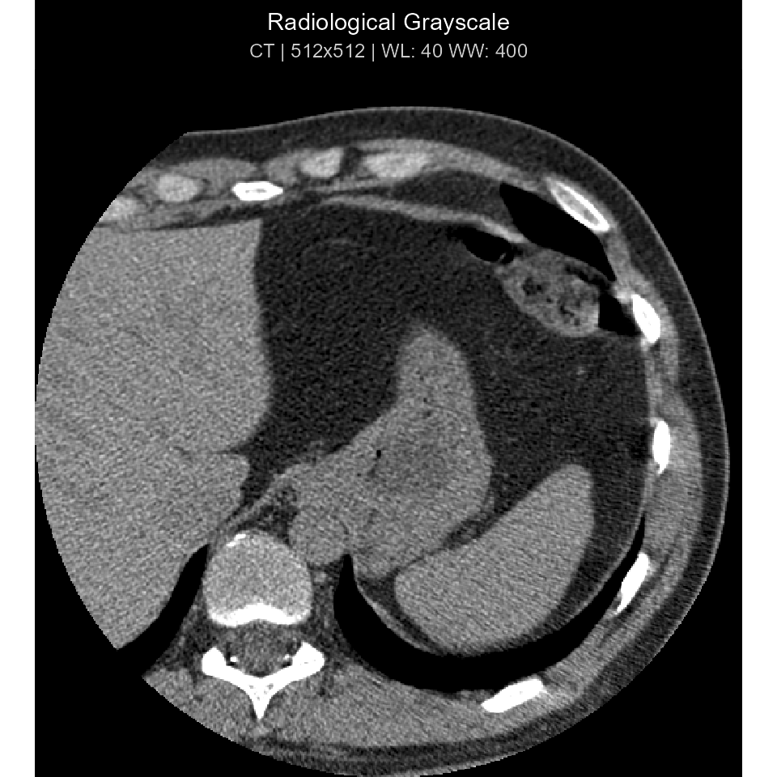
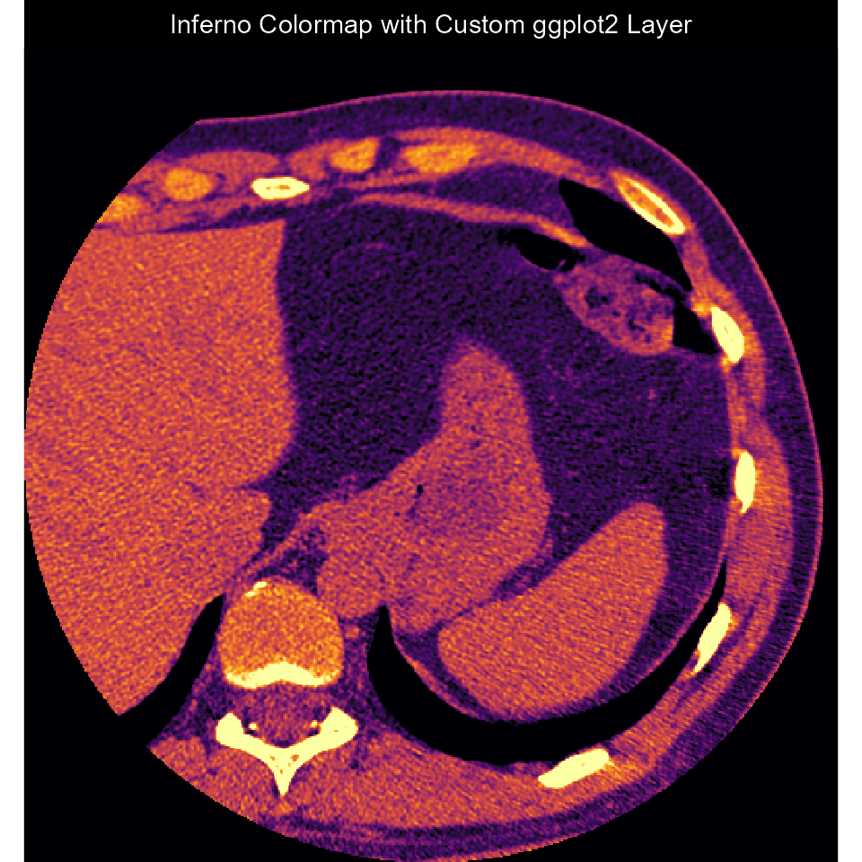
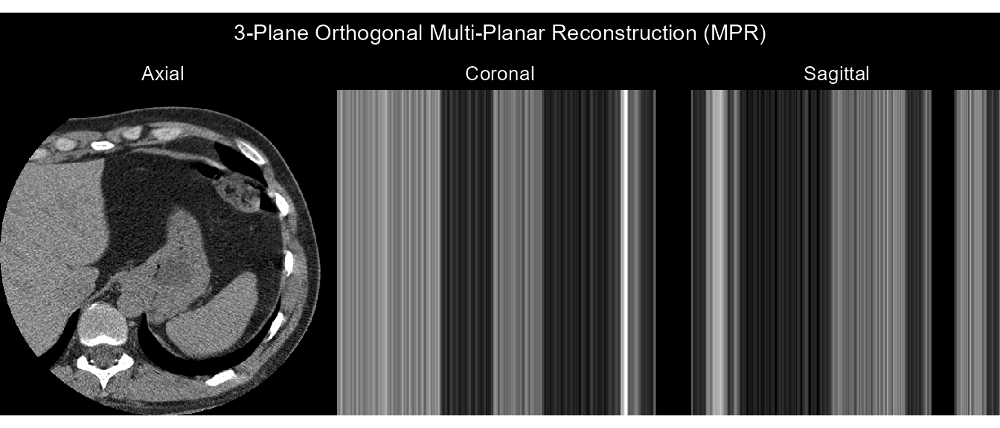
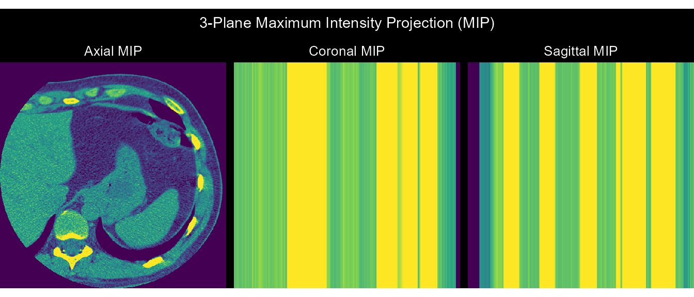

# DICOM Image Visualization: ggplot2, Clinical Windows, Shiny, and 3D Volumes

## Overview

`dicomtk` provides a complete medical image visualization pipeline built
on native C++17 pixel extraction
([`read_dicom_pixels()`](https://lauyeehow1986-hub.github.io/dicomtk/reference/read_dicom_pixels.md)),
VOI LUT window/level presets
([`dicom_window()`](https://lauyeehow1986-hub.github.io/dicomtk/reference/dicom_window.md)),
composable `ggplot2` rendering
([`plot_dicom()`](https://lauyeehow1986-hub.github.io/dicomtk/reference/plot_dicom.md)
/
[`ggdicom()`](https://lauyeehow1986-hub.github.io/dicomtk/reference/ggdicom.md)),
an interactive `Shiny` viewer
([`dicom_viewer()`](https://lauyeehow1986-hub.github.io/dicomtk/reference/dicom_viewer.md)),
and 3D volumetric rendering
([`render_volume()`](https://lauyeehow1986-hub.github.io/dicomtk/reference/render_volume.md)).

[`library`](https://rdrr.io/r/base/library.html)`(`[`dicomtk`](https://github.com/lauyeehow1986-hub/dicomtk)`)`` `[`library`](https://rdrr.io/r/base/library.html)`(`[`ggplot2`](https://ggplot2.tidyverse.org)`)`` ``#> Warning: package 'ggplot2' was built under R version 4.5.3`` `` ``dcm_file`` ``<-`` `[`system.file`](https://rdrr.io/r/base/system.file.html)`(``"extdata"``, ``"example.dcm"``, package ``=`` ``"dicomtk"``)`

## Extracting Pixel Data & Applying Clinical Window Presets

[`read_dicom_pixels()`](https://lauyeehow1986-hub.github.io/dicomtk/reference/read_dicom_pixels.md)
decodes 8-bit, 16-bit, or 32-bit monochrome and RGB pixel streams
(including RLE-compressed frames) and applies Modality LUT rescaling
(`RescaleSlope` and `RescaleIntercept`):

`px`` ``<-`` `[`read_dicom_pixels`](https://lauyeehow1986-hub.github.io/dicomtk/reference/read_dicom_pixels.md)`(``dcm_file``)`` `[`dim`](https://rdrr.io/r/base/dim.html)`(``px``)`` ``#> [1] 512 512`` `` ``# Apply clinical window presets ("auto", "brain", "stroke", "subdural",`` ``# "lung", "mediastinum", "abdomen", "liver", "bone", "angio")`` ``win_brain`` ``<-`` `[`dicom_window`](https://lauyeehow1986-hub.github.io/dicomtk/reference/dicom_window.md)`(``px``, preset ``=`` ``"brain"``)`` `[`range`](https://rdrr.io/r/base/range.html)`(``win_brain``)`` ``#> [1] 0 1`

## Composable `ggplot2` Rendering (`plot_dicom()` & `ggdicom()`)

[`plot_dicom`](https://lauyeehow1986-hub.github.io/dicomtk/reference/plot_dicom.md)`(``dcm_file``, window ``=`` ``"auto"``, palette ``=`` ``"gray"``, title ``=`` ``"Radiological Grayscale"``)`

` ``# Add custom ggplot2 annotations on top of ggdicom()`` `[`ggdicom`](https://lauyeehow1986-hub.github.io/dicomtk/reference/ggdicom.md)`(``dcm_file``, palette ``=`` ``"inferno"``, annotate ``=`` ``FALSE``)`` ``+`` `` `[`labs`](https://ggplot2.tidyverse.org/reference/labs.html)`(``title ``=`` ``"Inferno Colormap with Custom ggplot2 Layer"``)`

## 3D Volumetric Multi-Planar Reconstruction (MPR) & Maximum Intensity Projection (MIP)

`series`` ``<-`` `[`read_dicom_series`](https://lauyeehow1986-hub.github.io/dicomtk/reference/read_dicom_series.md)`(`[`c`](https://rdrr.io/r/base/c.html)`(``dcm_file``, ``dcm_file``, ``dcm_file``)``)`` ``series`` ``#> ``ℹ`` DICOM Series: 512 x 512 x 3 slices (3 files)`` `` ``# 3-Plane Orthogonal MPR`` `[`render_volume`](https://lauyeehow1986-hub.github.io/dicomtk/reference/render_volume.md)`(``series``, method ``=`` ``"mpr"``)`

` ``# 3-Plane Maximum Intensity Projection (MIP)`` `[`render_volume`](https://lauyeehow1986-hub.github.io/dicomtk/reference/render_volume.md)`(``series``, method ``=`` ``"mip"``, palette ``=`` ``"viridis"``)`

## Interactive Shiny Viewer

In an interactive R session, call
[`dicom_viewer()`](https://lauyeehow1986-hub.github.io/dicomtk/reference/dicom_viewer.md)
to launch a full multi-slice DICOM workstation in your browser or IDE
viewer pane:

`if`` ``(`[`interactive`](https://rdrr.io/r/base/interactive.html)`(``)``)`` ``{`` `` `[`dicom_viewer`](https://lauyeehow1986-hub.github.io/dicomtk/reference/dicom_viewer.md)`(``dcm_file``)`` ``}`
